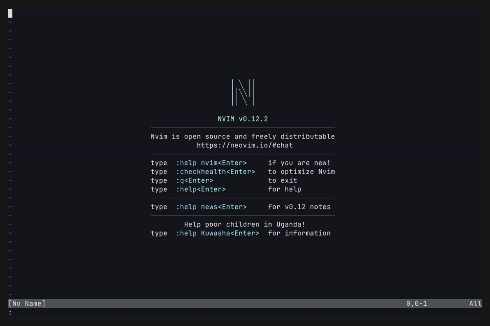

# bin.nvim

A Neovim plugin that opens ELF binaries as structured, human-readable inspection
buffers instead of raw binary content.

When you open an ELF file, the buffer is populated with the output of several
analysis tools organised into collapsible sections. All sections are loaded in
parallel; missing optional tools display a short notice rather than an error.

## Demo



## Requirements

- Neovim >= 0.10 (for `vim.system`)
- `readelf` — required (part of binutils)
- `file`, `size`, `strings`, `ldd` — optional (binutils / glibc)
- `checksec` — optional
- `c++filt`, `rustfilt` — optional, used for C++ and Rust symbol demangling

Run `:checkhealth bin` to verify which tools are missing on your system.

## Installation

### lazy.nvim

```lua
{
  "a-mango/bin.nvim",
  lazy = false,
  config = function()
    require("bin").setup()
  end,
}
```

### packer.nvim

```lua
use {
  "a-mango/bin.nvim",
  config = function()
    require("bin").setup()
  end,
}
```

Your plugin manager generates the help tags, so `:help bin.nvim` works once it
is installed.

## Configuration

`setup()` accepts an options table. All keys are optional and fall back to the
defaults shown below:

```lua
require("bin").setup({
  -- Sections to display, in order. Remove or reorder as needed.
  sections = {
    "file", "header", "checksec", "size",
    "sections", "segments", "dynamic",
    "notes", "versions", "relocations",
    "symbols", "strings", "ldd", "dwarf",
  },
  max_symbols    = 200,  -- maximum lines shown in the symbol table
  max_strings    = 300,  -- maximum strings shown
  min_string_len = 10,   -- minimum length passed to strings(1)
  max_dwarf      = 300,  -- maximum lines shown in the DWARF dump
  demangle       = true, -- demangle symbols via c++filt / rustfilt if available
})
```

## Keymaps

These keymaps are active only inside ELF inspection buffers.

| Key  | Action                        |
| ---- | ----------------------------- |
| `r`  | Reload and refresh the buffer |
| `q`  | Close the buffer              |
| `]]` | Jump to the next section      |
| `[[` | Jump to the previous section  |
| `zM` | Collapse all sections         |
| `zR` | Expand all sections           |
| `za` | Toggle the current section    |

## Output

Opening any ELF file (e.g. `nvim /usr/bin/ls`) replaces the buffer with the
inspection view. You can also inspect a file at any time with `:Bin` (current
file) or `:Bin /path/to/binary`. The buffer then looks like:

```
  bin.nvim — /usr/bin/ls
  ══════════════════════════════════════════════════════════

┌────────────────────────────────────────────────────────────
│  File
└────────────────────────────────────────────────────────────

  ELF 64-bit LSB pie executable, x86-64, dynamically linked, stripped

┌────────────────────────────────────────────────────────────
│  ELF Header
└────────────────────────────────────────────────────────────

  ELF Header:
    Magic:   7f 45 4c 46 02 01 01 00 00 00 00 00 00 00 00 00
    Class:                             ELF64
    Type:                              DYN (Position-Independent Executable file)
    Machine:                           Advanced Micro Devices X86-64
    Entry point address:               0x3910
    ...

┌────────────────────────────────────────────────────────────
│  Security Properties
└────────────────────────────────────────────────────────────

  RELRO:           Full RELRO
  Stack Canary:    Canary found
  NX:              NX enabled
  PIE:             PIE enabled
  RPATH:           No RPATH
  RUNPATH:         No RUNPATH
  Symbols:         No Symbols
  FORTIFY:         Partial
  Fortified:       11
  Fortifiable:     19

┌────────────────────────────────────────────────────────────
│  Section Sizes
└────────────────────────────────────────────────────────────

     text    data     bss     dec     hex  filename
   136774    5640    4848  147262   23f3e  /usr/bin/ls

┌────────────────────────────────────────────────────────────
│  Dynamic Section
└────────────────────────────────────────────────────────────

  Dynamic section at offset 0x239c8 contains 31 entries:
    Tag        Type                         Name/Value
   0x0000000000000001 (NEEDED)             Shared library: [libselinux.so.1]
   0x0000000000000001 (NEEDED)             Shared library: [libcap.so.2]
   0x0000000000000001 (NEEDED)             Shared library: [libc.so.6]
   ...

┌────────────────────────────────────────────────────────────
│  Shared Library Dependencies
└────────────────────────────────────────────────────────────

  libselinux.so.1 => /lib64/libselinux.so.1 (0x00007f4e5da00000)
  libcap.so.2 => /lib64/libcap.so.2 (0x00007f4e5d9f5000)
  libc.so.6 => /lib64/libc.so.6 (0x00007f4e5d800000)
  /lib64/ld-linux-x86-64.so.2 (0x00007f4e5dc48000)
```

Section Headers, Program Headers, Notes, Relocations, Version Information,
Symbol Table, Strings, and DWARF debug info follow in the same buffer.

Press `zM` to collapse all sections to their titles for a quick overview:

```
┌────────────────────────────────────────────────────────────
│  File
└────────────────────────────────────────────────────────────
  ··· 1 lines
┌────────────────────────────────────────────────────────────
│  ELF Header
└────────────────────────────────────────────────────────────
  ··· 20 lines
┌────────────────────────────────────────────────────────────
│  Security Properties
└────────────────────────────────────────────────────────────
  ··· 10 lines
  ...
```

Use `]]` / `[[` to move between sections, and `za` to expand the one you need.

## Limitations

Detection happens on `BufReadPost`, so Neovim reads the whole file into a buffer
before the inspection view replaces it. On a large or stripped binary that costs
some memory and a brief pause before the summary shows. Intercepting earlier
would avoid the read but blanks ordinary non-ELF buffers, so the current
behaviour is a deliberate trade.

## License

MIT
